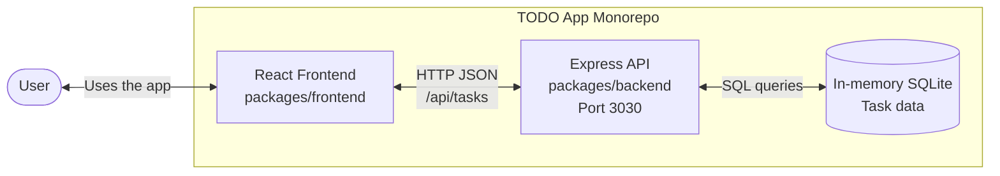
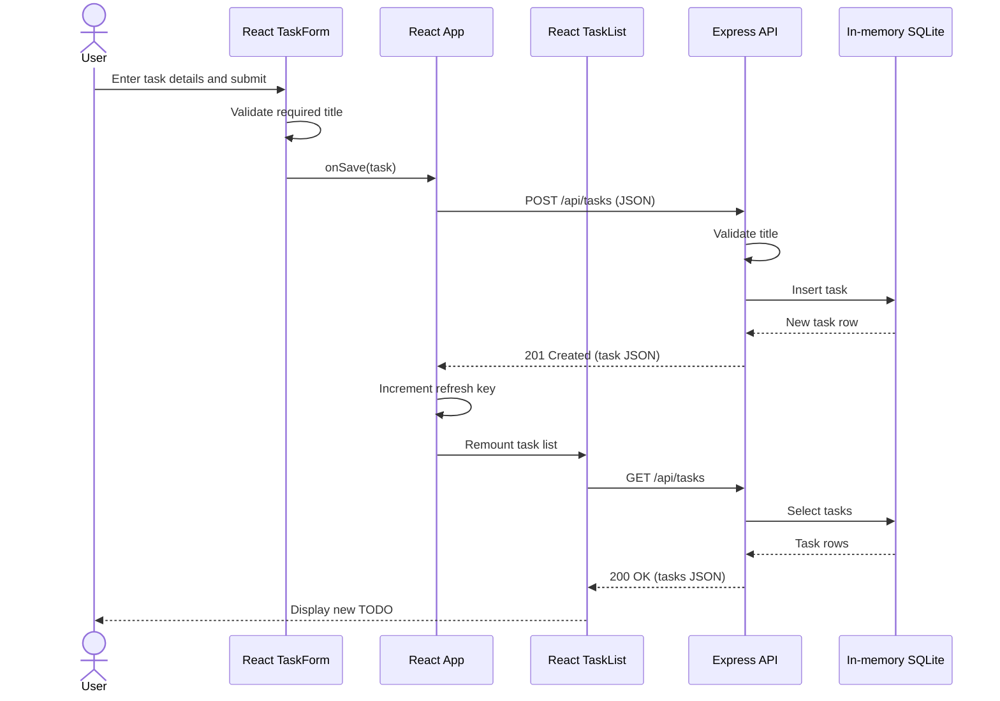

# Cloud Architecture Overview

The TODO app runs as a React frontend and an Express API in this monorepo. The API reads and writes task data in an in-memory SQLite database; task data is lost when the backend process stops.

## Sequence: Creating a TODO

