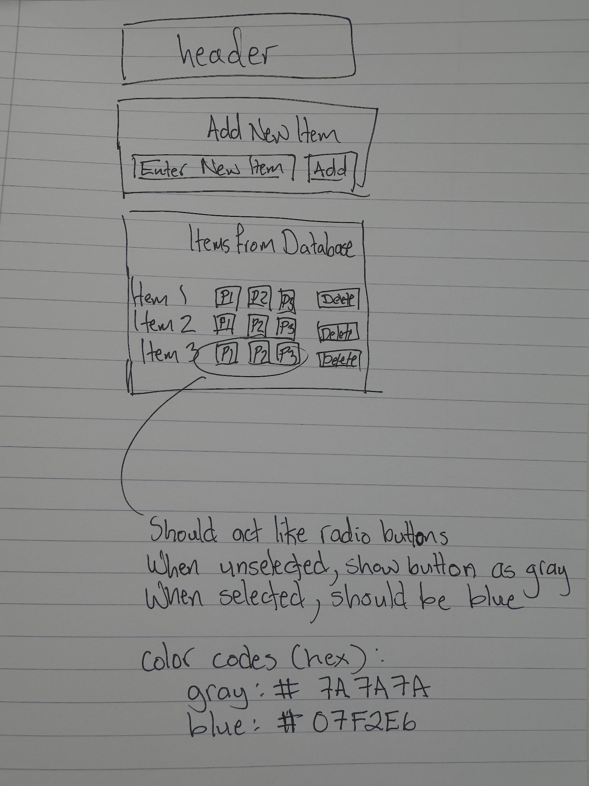

# Story: Add priority field with default P3

## Acceptance Criteria

- New tasks created without an explicit priority are stored with priority value "P3".
- Priority field supports only values "P1", "P2", "P3".

## Technical Requirements

- Extend in-memory task object shape in frontend state to include `priority`.
- When mapping backend `/api/tasks` records into frontend state, merge a stored priority or default missing values to `P3`.
- Persist selected priorities in browser local storage, keyed by the existing task ID, because the current API and database do not store priority.
- Add an exclusive per-task priority control constrained to P1/P2/P3.

## UI Reference

Priority choices should behave as exclusive radio buttons. Unselected choices use gray `#7A7A7A`; the selected choice uses blue `#07F2E6`.
